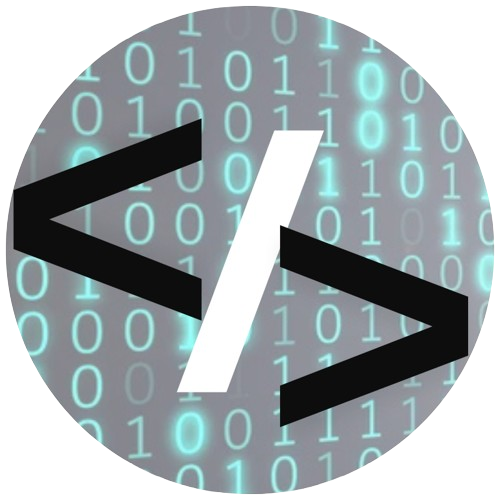

<h2 id="sobre-o-projeto">1. 📊 BI-Python: Inteligência de Dados:</h2>


> Bem-vindo ao `Atacadão Dashboard de Paletes!` Uma solução de Business Intelligence `Open Source` desenvolvida para otimizar o controle de estoque de paletes no Centro de Distribuição - CD. O projeto visa resolver a dor da rastreabilidade de NFs com devoluções parciais de motoristas, utilizando dados extraídos do sistema `Cerberus.`

---

## 📚 Tabela de Conteúdo

| 📊 O Projeto | 🛠️ Técnico | 🤝 Comunidade |
| :---: | :---: | :---: |
| [](#sobre-o-projeto) | [](#destaques-tecnicos) | [](#codigo-fonte) |
| [](#tecnologias-utilizadas) | [](#estrutura-do-projeto) | [](#créditos) |
| [](#como-rodar-localmente) | [](#como-contribuir) | [](#licenca) |
| [](#insights-principais) | [](#faq) | [](#perfil-do-github) |

---

<h2 id="sobre-o-projeto">1. BI-Python: Inteligência de Dados 📊</h2>

No setor de Recebimento de Mercadorias, o controle manual de paletes gera duas dores principais:
1. **Retenção de Paletes:** Motoristas que não levam todos os paletes de volta deixam um "saldo retido" no CD. No caso do CHEP , isso impacta diretamente no custo financeiro.
2. **Rastreabilidade:** Dificuldade em referenciar qual Nota Fiscal - NF , de entrada , originou aquela retenção parcial, dificultando cobranças futuras ou devoluções em lote.

Este Dashboard atua como uma camada de inteligência sobre os dados do Sistema. Através da exportação de relatórios em CSV, o script em Python cruza as informações , calcula o saldo retido e cria um **Status de Rastreamento** vinculado à NF original.

---

<h2 id="tecnologias-utilizadas">2. ⚙️ Tecnologias Utilizadas</h2>

| Camada | Tecnologias | Descrição |
| :--- | :--- | :--- |
| **Linguagem** |  | Core da análise e lógica de ETL. |
| **Processamento** |  | Tratamento de dados, cálculos de saldo e agrupamentos. |
| **Dashboard** |  | Interface web interativa e responsiva. |
| **Visualização** |  | Gráficos dinâmicos e interativos. |

---

<h2 id="como-acessar">3. 🚀 Como Acessar</h2>

Clique no botão abaixo para iniciar o Verificador de Idade diretamente no seu navegador:

<div align="left">
  <a href="https://domisnnet.github.io/Age-Checker-Web-Essentials/" target="_blank">
    
  </a>
</div>


---

<h2 id="funcionalidades">4. 🧩 Funcionalidades Principais</h2>

O projeto foca em simplicidade e feedback instantâneo para o usuário:

| Funcionalidade | Impacto |
| :--- | :--- |
| 📉 **Retenção por Fornecedor** | Identificação de quais fornecedores têm maior índice de paletes não devolvidos. |
| 💬 **Rastreabilidade de NF** | Vinculação direta da NF de devolução parcial com a NF de entrada original. |
| 🔗 **Impacto Financeiro - CHEP** | Visibilidade do volume de paletes alugados que estão retidos no pátio, evitando multas. |
| ⚠️ **Acuracidade de Estoque** | Sistema de verificação do Estoque Físico com o Estoque no Sistema , visando maior acuracidade. |
| 📱 **Design Adaptável** | Interface limpa que permite a verificação em diferentes telas. |

---

<h2 id="destaques-tecnicos">5. 💻 Destaques Técnicos</h2>

O projeto foi construído com foco em **Reprodutibilidade** e **Clareza Analítica**:

<h3>🧹 Pipeline de Limpeza Robusto:</h3>

Tratamento sistemático de campos nulos, duplicados e padronização de tipos antes de qualquer análise, garantindo que os Dados sejam  confiáveis.

<h3>🔒 Segurança e Privacidade - Nota ao CPD/TI:</h3>

Este repositório é público e foi criado estritamente para fins de estudo e demonstração de Prova de Conceito.
Nenhum dado real do Atacadão está armazenado neste repositório.
O arquivo data/raw/dados_palete.csv contém dados fictícios para simulação.
O arquivo .gitignore está configurado para bloquear qualquer upload de dados sensíveis extraídos do sistema.

---

<h2 id="estrutura-do-projeto">6. 📂 Estrutura do Projeto</h2>

```text
Atacadao-Dashboard-Palete-Python
├── data/
│   └── raw/                📌 Datasets originais - CSV.
├── notebooks/
│   └── inicial.ipynb       📌 Notebook principal de análise.
├── assets/
│   └── png/                📌 Gráficos e telas exportadas.
├── src/                    📌 Scripts utilitários.
├── requirements.txt        📌 Dependências Python.
└── README.md               📌 Documentação Técnica.
```

---

<h2 id="como-contribuir">7. 🤝 Como Contribuir</h2>

Deseja melhorar o design ou adicionar novas métricas? Siga o fluxo oficial:

| Fase | Ação | Link / Comando |
| :---: | :--- | :--- |
| **01** | **Fork** | [](https://github.com/Domisnnet/Atacadao-Dashboard-Palete-Python/fork) |
| **02** | **Branch** | `git checkout -b feature/NovoGrafico` |
| **03** | **Commit** | `git commit -m 'feat: add gráfico de estrelas'` |
| **04** | **Push** | `git push origin feature/NovoGrafico` |
| **05** | **PR** | [](https://github.com/Domisnnet/Atacadao-Dashboard-Palete-Python/compare)

<h3>🐛 Encontrou um problema?</h3>

Se algo não estiver funcionando como esperado, não hesite em abrir um chamado:

[](https://github.com/Domisnnet/Customer-Retention-Insights-Python/issues)
[](https://github.com/Domisnnet/Atacadao-Dashboard-Palete-Python/issues/new)

---

<h2 id="faq">8. 🧠 Perguntas Frequentes</h2>

<details>
<summary><strong>Os dados são reais ou fictícios ❓</strong></summary>
<p>
  📊 <strong>Resposta:</strong> Os dados utilizados são amostras representativas <code>dados_palete.csv</code> para fins de demonstração e estudo de técnicas de BI.
</p>
</details>

<details>
<summary><strong>Onde estão os dados reais do Atacadão ❓</strong></summary>
<p>
  ✅ <strong>Resposta:</strong>Por questões de segurança da informação, os dados reais extraídos do Cerberus rodam apenas em ambiente local ou interno da empresa, nunca sendo enviados para a nuvem deste repositório público
</p>
</details>

<details>
<summary><strong>Como adicionar novos gráficos ❓</strong></summary>
<p>
  🎨 <strong>Resposta:</strong>Crie um novo bloco no arquivo <code>app/main.py</code>, importe o Plotly e utilize o <code>st.plotly_chart()</code> para renderizar o novo gráfico no Streamlit.
</p>
</details>

---

<h2 id="codigo-fonte">9. 💻 Código Fonte</h2>

Deseja analisar a lógica de processamento? Explore o Repositório Oficial:

[](https://github.com/Domisnnet/Atacadao-Dashboard-Palete-Python)

---

<h2 id="créditos">10. 📝 Créditos & Reconhecimentos</h2>

O **BI-Python** é resultado de estudo contínuo em Data Science:

| Atribuição | Responsável / Recurso | Descrição |
| :--- | :--- | :--- |
| **Análise de Dados** | **DomisDev** | Exploração, limpeza e visualização dos datasets. |
| **Empresa:** | | **Atacadão - CD**  | Contexto de negócio e origem dos dados. |
| **Engine Gráfica** | **Plotly & Streamlit** | Base para renderização estatística precisa. |
| **Manipulação** | **Pandas** | Processamento eficiente de tabelas e séries temporais. |
| **Apoio Técnico** | **Google Gemini** | Padronização e refinamento documental. |

---

<h2 id="licenca">11. 📄 Licença</h2>

Este projeto está licenciado sob a &nbsp;[](https://github.com/Domisnnet/Atacadão-Dashboard-Palete-Python/blob/main/LICENSE)

---

<h2 id="perfil-do-github">12. 👨‍💻 Perfil do GitHub</h2>

<a href="https://github.com/Domisnnet"> 
   
</a>

&nbsp;
<p align="center">
  <a href="#sobre-o-projeto">
    
  </a>
</p>
